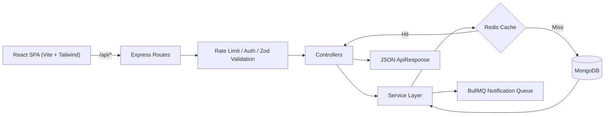

# LocalConnect – Full-Stack Hyperlocal Community Platform

**LocalConnect** is a full-stack hyperlocal community platform inspired by Lokal. Users can discover nearby location-based communities, share local updates, publish categorized posts, comment, like, follow neighbors, and browse a personalized, Redis-cached feed.

---

## Table of Contents

1. [Project Overview](#1-project-overview)
2. [Features](#2-features)
3. [Tech Stack](#3-tech-stack)
4. [Architecture](#4-architecture)
5. [Folder Structure](#5-folder-structure)
6. [Database Design & Indexing](#6-database-design--indexing)
7. [Redis Caching & Invalidation](#7-redis-caching--invalidation)
8. [Authentication Workflow](#8-authentication-workflow)
9. [API Documentation](#9-api-documentation)
10. [Docker Setup](#10-docker-setup)
11. [Local Development Setup](#11-local-development-setup)
12. [Environment Variables](#12-environment-variables)
13. [Testing Instructions](#13-testing-instructions)
14. [Postman Collection](#14-postman-collection)
15. [Screenshots](#15-screenshots)

---

## 1. Project Overview

LocalConnect organizes hyperlocal information—neighborhood news, local jobs, events, and community discussions—into structured, city-based communities backed by a modular monolithic Express/MongoDB/Redis API and a responsive React + Tailwind CSS frontend.

---

## 2. Features

- **Frontend (React + Vite + Tailwind CSS)**:
  - Landing page with live community discovery preview.
  - Registration, Login, and Protected Routes with automatic JWT refresh token rotation.
  - Three-column Dashboard with Create Post box, category/sort/personalized feed filters, Trending Communities, and Popular Posts.
  - Community Explorer with search, location filtering, community creation, join/leave, and Community Details (posts & members).
  - Post editing, deletion, atomic likes, and inline expandable comments.
  - User Profile with user's posts, followers, following, follow/unfollow, and profile editing.
  - Loading skeletons, toast notifications, empty states, and error states.
- **Backend (Node.js + Express + MongoDB + Redis + BullMQ)**:
  - Modular MVC + Service Layer architecture.
  - JWT access tokens + SHA-256 hashed refresh tokens with rotation & reuse detection.
  - Redis cache-aside for community feeds, popular posts, and community details with graceful fallback to MongoDB.
  - Redis-backed rate limiting, Helmet, CORS, Zod validation, and NoSQL injection sanitization.
  - BullMQ background queue & worker for post notification processing.

---

## 3. Tech Stack

- **Frontend**: React.js, Vite, Tailwind CSS, React Router, Axios, React Context API, Lucide Icons
- **Backend**: Node.js (ES6+), Express.js, MongoDB, Mongoose, Redis (`ioredis`), BullMQ, JWT, `bcrypt`, Zod
- **Security**: Helmet, CORS, `express-mongo-sanitize`, `express-rate-limit` (`rate-limit-redis`)
- **Testing & Tooling**: Jest, Supertest, `mongodb-memory-server`, Docker, Docker Compose, Postman

---

## 4. Architecture



---

## 5. Folder Structure

```text
localConnect/
├── client/                  # React + Vite + Tailwind CSS frontend
│   ├── src/
│   │   ├── components/      # Navbar, PostCard, CreatePostBox, CommunityCard, etc.
│   │   ├── pages/           # Landing, Login, Register, Dashboard, Communities, Profile, Settings
│   │   ├── layouts/         # Three-column DashboardLayout
│   │   ├── context/         # AuthContext, ToastContext
│   │   ├── services/        # Axios API client with refresh interceptor & domain services
│   │   └── utils/           # Category constants & relative time formatting
│   ├── Dockerfile
│   └── nginx.conf
├── server/                  # Express + MongoDB + Redis + BullMQ backend
│   ├── src/
│   │   ├── config/          # Environment, MongoDB, Redis
│   │   ├── controllers/     # Thin HTTP handlers
│   │   ├── services/        # Business logic & cache-aside orchestration
│   │   ├── models/          # Mongoose schemas & indexes
│   │   ├── routes/          # Express route definitions
│   │   ├── middlewares/     # Auth, RBAC, Zod validation, rate limiting, error handler
│   │   ├── validators/      # Zod schemas
│   │   ├── utils/           # ApiError, ApiResponse, asyncHandler, JWT & cache keys
│   │   ├── jobs/            # BullMQ notification worker
│   │   ├── app.js
│   │   └── server.js
│   ├── tests/               # Jest & Supertest integration tests
│   └── Dockerfile
├── postman/
│   └── LocalConnect.postman_collection.json
├── docker-compose.yml
├── .env.example
└── README.md
```

---

## 6. Database Design & Indexing

- **Users**: `email` (unique), `location` index.
- **RefreshTokens**: `userId` index, `tokenHash` (unique), `expiresAt` TTL index (`expireAfterSeconds: 0`).
- **Communities**: `location`, `name`, and text index on `name`, `description`, `location`.
- **Posts**: Compound indexes `{ communityId: 1, createdAt: -1 }`, `{ userId: 1, createdAt: -1 }`, `{ category: 1, createdAt: -1 }`, `{ location: 1, createdAt: -1 }`, `{ likesCount: -1, createdAt: -1 }`, and `{ createdAt: -1 }`.
- **Comments**: Compound index `{ postId: 1, createdAt: -1 }`.

---

## 7. Redis Caching & Invalidation

- **Cache-Aside**: Community lists, community details, community/global feeds, and popular posts check Redis first (`X-Cache: HIT` / `MISS`). On a miss, data is fetched from MongoDB and cached with configurable TTLs.
- **Invalidation**: Creating, updating, deleting, liking, or unliking a post invalidates `feed:community:<id>:*`, `feed:global:*`, and `posts:popular:*`. Joining, leaving, updating, or deleting a community invalidates community and feed keys.
- **Resilience**: If Redis is unreachable, `isRedisAvailable()` returns `false` and requests fall back to MongoDB.

---

## 8. Authentication Workflow

1. User registers or logs in; password is verified/hashed with `bcrypt`.
2. Backend returns a short-lived JWT access token (`15m`) and a refresh token (`7d`) whose SHA-256 hash is stored in MongoDB.
3. Frontend Axios interceptor attaches the access token and automatically calls `POST /api/auth/refresh` on `401` responses to rotate tokens.
4. Logout (`POST /api/auth/logout`) revokes the refresh token in MongoDB.

---

## 9. API Documentation

- **Auth**: `POST /api/auth/register`, `POST /api/auth/login`, `POST /api/auth/refresh`, `POST /api/auth/logout`, `GET /api/auth/me`
- **Users**: `GET /api/users/me`, `PUT /api/users/me`, `GET /api/users/:id`, `POST /api/users/:id/follow`, `DELETE /api/users/:id/follow`, `GET /api/users/:id/followers`, `GET /api/users/:id/following`, `GET /api/users/:id/stats`
- **Communities**: `POST /api/communities`, `GET /api/communities`, `GET /api/communities/:id`, `POST /api/communities/:id/join`, `DELETE /api/communities/:id/join`, `GET /api/communities/:id/members`, `GET /api/communities/:id/posts`
- **Posts**: `POST /api/posts`, `GET /api/posts`, `GET /api/posts/popular`, `GET /api/posts/:id`, `PUT /api/posts/:id`, `DELETE /api/posts/:id`, `POST /api/posts/:id/like`, `DELETE /api/posts/:id/like`
- **Comments**: `POST /api/posts/:postId/comments`, `GET /api/posts/:postId/comments`, `PUT /api/comments/:id`, `DELETE /api/comments/:id`
- **Feed**: `GET /api/feed?page=1&limit=10&sort=latest&category=...&communityId=...`

---

## 10. Docker Setup

Run the full stack (React frontend, Express backend, MongoDB, Redis):

```bash
docker compose up --build
```

- Frontend: `http://localhost:3000`
- Backend API: `http://localhost:5000`

---

## 11. Local Development Setup

### Backend
```bash
cd server
cp .env.example .env
npm install
npm run dev
```

### Frontend
```bash
cd client
npm install
npm run dev
```

---

## 12. Environment Variables

See `.env.example` for backend variables (`PORT`, `MONGO_URI`, `REDIS_HOST`, `REDIS_PORT`, `JWT_ACCESS_SECRET`, `JWT_REFRESH_SECRET`, `CORS_ORIGIN`, `CACHE_TTL_*`, `RATE_LIMIT_*`) and `client/.env.example` for `VITE_API_URL`.

---

## 13. Testing Instructions

```bash
cd server
npm test
```

---

## 14. Postman Collection

Import `postman/LocalConnect.postman_collection.json` into Postman. Collection variables (`baseUrl`, `accessToken`, `refreshToken`, `userId`, `communityId`, `postId`) are automatically populated by test scripts.

---

## 15. Screenshots

Add screenshots of the Landing Page, Dashboard Feed, Community Explorer, and User Profile here after running the app locally.

