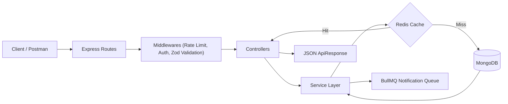

# LocalConnect – Scalable Hyperlocal Community Backend

**LocalConnect** is a production-oriented RESTful backend platform inspired by hyperlocal community apps like Lokal. Users can register, join location-based communities (e.g., *Srinagar Community*, *Delhi Community*, *Bangalore Community*), publish and interact with posts, follow neighbors, and browse a personalized, Redis-cached hyperlocal feed.

---

## Table of Contents

1. [Project Overview & Problem Statement](#1-project-overview--problem-statement)
2. [Features](#2-features)
3. [Tech Stack](#3-tech-stack)
4. [Architecture & Request Flow](#4-architecture--request-flow)
5. [Folder Structure](#5-folder-structure)
6. [Database Schema & Indexing Strategy](#6-database-schema--indexing-strategy)
7. [Authentication Workflow](#7-authentication-workflow)
8. [Redis Caching & Invalidation Strategy](#8-redis-caching--invalidation-strategy)
9. [Rate Limiting & Security](#9-rate-limiting--security)
10. [Background Job Processing (BullMQ)](#10-background-job-processing-bullmq)
11. [API Documentation](#11-api-documentation)
12. [Docker Setup](#12-docker-setup)
13. [Local Development Setup](#13-local-development-setup)
14. [Environment Variables](#14-environment-variables)
15. [Testing](#15-testing)
16. [Postman Collection](#16-postman-collection)
17. [Future Improvements](#17-future-improvements)

---

## 1. Project Overview & Problem Statement

Hyperlocal information—local jobs, community events, neighborhood news, and educational opportunities—is often scattered across unorganized chat groups. **LocalConnect** provides a structured, scalable backend API that organizes local engagement around location-based communities, social graphs, and fast, paginated feeds.

---

## 2. Features

- **Authentication & Authorization**: JWT access tokens, SHA-256 hashed refresh tokens with rotation & reuse detection, logout revocation, bcrypt password hashing, and role-based access control (`USER`, `ADMIN`).
- **User Management**: Profile updates, location updates, follow/unfollow with atomic duplicate prevention, paginated followers/following lists, and user statistics.
- **Community Management**: Create, search, filter by location, join/leave atomically, list members, list posts, and delete communities.
- **Post & Comment Management**: CRUD operations with ownership/admin checks, 7 categories (`Education`, `Jobs`, `News`, `Events`, `Technology`, `Business`, `General`), atomic like/unlike, and paginated comments.
- **Hyperlocal Feed**: Paginated, sortable (`latest`, `popular`, `oldest`), filterable by category, community, and location, plus personalized feeds from joined communities and followed users.
- **Redis Caching**: Cache-aside pattern for community feeds, popular posts, and community metadata, with pattern-based invalidation and graceful fallback to MongoDB if Redis is unavailable.
- **Rate Limiting & Security**: Redis-backed `express-rate-limit` (global + stricter auth limits), Helmet headers, CORS, Zod request validation, NoSQL injection sanitization, and centralized error handling.
- **Background Jobs**: BullMQ queue and worker for asynchronous post notification processing with exponential backoff retries.

---

## 3. Tech Stack

- **Runtime**: Node.js (ES6+ Modules)
- **Framework**: Express.js
- **Database**: MongoDB with Mongoose
- **Caching & Queue**: Redis (`ioredis`) & BullMQ
- **Authentication**: JSON Web Tokens (`jsonwebtoken`) & `bcrypt`
- **Validation**: Zod
- **Security**: Helmet, CORS, `express-mongo-sanitize`, `express-rate-limit` (`rate-limit-redis`)
- **Testing**: Jest & Supertest (`mongodb-memory-server`)
- **Containerization**: Docker & Docker Compose

---

## 4. Architecture & Request Flow

LocalConnect follows a **Modular Monolith (MVC + Service Layer)** architecture. Controllers handle HTTP concerns only; all business logic, atomic database updates, and cache coordination live in the service layer.



**Request Lifecycle**:
`Client → Express Route → Middleware (RateLimiter / Auth / Zod) → Controller → Service → Redis / MongoDB → Centralized ApiResponse / ErrorHandler`

---

## 5. Folder Structure

```text
backend/
├── src/
│   ├── config/          # Environment, MongoDB, and Redis configuration
│   ├── controllers/     # Thin HTTP request/response handlers
│   ├── services/        # Business logic, caching, and DB operations
│   ├── models/          # Mongoose schemas and indexes
│   ├── routes/          # Express route definitions
│   ├── middlewares/     # Auth, RBAC, Zod validation, rate limiting, error handling
│   ├── validators/      # Zod schemas
│   ├── utils/           # ApiError, ApiResponse, asyncHandler, JWT & cache key helpers
│   ├── jobs/            # BullMQ notification queue and worker
│   ├── app.js           # Express app setup
│   └── server.js        # Server bootstrap and graceful shutdown
├── tests/               # Jest & Supertest integration tests
├── postman/             # Postman collection JSON
├── Dockerfile
├── docker-compose.yml
├── .env.example
└── package.json
```

---

## 6. Database Schema & Indexing Strategy

### Collections
- **Users**: `name`, `email` (unique), `password` (`select: false`), `role`, `bio`, `location`, `followers[]`, `following[]`, `joinedCommunities[]`.
- **RefreshTokens**: `userId`, `tokenHash` (unique), `expiresAt` (TTL index), `revokedAt`, `replacedByTokenHash`.
- **Communities**: `name`, `description`, `location`, `createdBy`, `members[]`, `membersCount`.
- **Posts**: `userId`, `communityId`, `title`, `content`, `category`, `location` (denormalized from community), `likes[]`, `likesCount`, `commentsCount`.
- **Comments**: `postId`, `userId`, `content`.

### Why These Indexes Exist
- `Users: { email: 1 } (unique)` — Enforces unique accounts and enables $O(\log N)$ login lookups.
- `Users: { location: 1 }` — Speeds up location-based user discovery.
- `RefreshTokens: { expiresAt: 1 } (TTL: 0)` — Automatically purges expired refresh tokens from MongoDB.
- `Communities: { location: 1 }, { name: 1 }` — Optimizes filtering and sorting local communities.
- `Posts: { communityId: 1, createdAt: -1 }` — Powers community feeds sorted by newest without in-memory sorting.
- `Posts: { userId: 1, createdAt: -1 }` — Powers user post history and personalized feeds.
- `Posts: { category: 1, createdAt: -1 }` — Optimizes category-filtered feeds.
- `Posts: { location: 1, createdAt: -1 }` — Enables fast hyperlocal feed queries without `$lookup` joins.
- `Posts: { likesCount: -1, createdAt: -1 }` — Powers popular posts and `sort=popular` queries.
- `Comments: { postId: 1, createdAt: -1 }` — Retrieves paginated comments for a post in reverse chronological order.

---

## 7. Authentication Workflow

1. **Register / Login**: Password is verified/hashed with `bcrypt` (12 salt rounds). Server issues a short-lived **JWT Access Token** (`15m`) and a **JWT Refresh Token** (`7d`).
2. **Secure Token Storage**: Refresh tokens are hashed with SHA-256 before being stored in MongoDB.
3. **Token Rotation & Reuse Detection**: Calling `POST /api/auth/refresh-token` revokes the presented token and issues a new pair. If a revoked token is reused, all active refresh tokens for that user are immediately revoked.
4. **Logout**: `POST /api/auth/logout` marks the refresh token as revoked.

---

## 8. Redis Caching & Invalidation Strategy

LocalConnect implements a **cache-aside** pattern via `src/services/cache.service.js`:
- **Cached Endpoints**:
  - `GET /api/communities` (`communities:list:<hash>`, TTL: `300s`)
  - `GET /api/communities/:id` (`community:<id>`, TTL: `300s`)
  - `GET /api/feed` for community and global feeds (`feed:community:<id>:<hash>` / `feed:global:<hash>`, TTL: `120s`)
  - `GET /api/posts/popular` (`posts:popular:<limit>`, TTL: `180s`)
- **Cache Invalidation**:
  - Creating, updating, deleting, liking, or unliking a post invalidates `feed:community:<id>:*`, `feed:global:*`, and `posts:popular:*`.
  - Updating, joining, leaving, or deleting a community invalidates `community:<id>`, `communities:list:*`, and `feed:community:<id>:*`.
- **Graceful Degradation**: If Redis is disconnected, `isRedisAvailable()` returns `false` and requests fall back directly to MongoDB without failing.

---

## 9. Rate Limiting & Security

- **Global Rate Limiter**: 100 requests per 15 minutes per IP on `/api/*`.
- **Auth Rate Limiter**: 10 requests per 15 minutes per IP on `/api/auth/register` and `/api/auth/login`.
- **Redis Store**: Uses `rate-limit-redis` when Redis is connected so limits are shared across instances.
- **Hardening**: `helmet`, `cors`, `express-mongo-sanitize`, strict Zod input validation, and production error masking.

---

## 10. Background Job Processing (BullMQ)

When a post is created (`POST /api/posts`), `enqueuePostNotification` adds a `new-post-notification` job to the BullMQ `notifications` queue backed by Redis. The worker (`src/jobs/notification.worker.js`) processes notifications asynchronously with 3 retry attempts and exponential backoff. If Redis is unavailable, post creation still succeeds.

---

## 11. API Documentation

All responses follow a consistent JSON envelope:

```json
// Success
{
  "success": true,
  "message": "Post created successfully",
  "data": {},
  "meta": {}
}

// Error
{
  "success": false,
  "message": "Validation failed",
  "errors": []
}
```

### Endpoints Summary

| Module | Method | Endpoint | Auth | Description |
| :--- | :--- | :--- | :--- | :--- |
| **Health** | `GET` | `/health` | Public | API, MongoDB & Redis status |
| **Auth** | `POST` | `/api/auth/register` | Public | Register a new user |
| **Auth** | `POST` | `/api/auth/login` | Public | Login and receive tokens |
| **Auth** | `POST` | `/api/auth/refresh-token` | Public | Rotate refresh token |
| **Auth** | `POST` | `/api/auth/logout` | Public | Revoke refresh token |
| **Auth** | `GET` | `/api/auth/me` | Bearer | Get current user profile |
| **Users** | `GET` | `/api/users/:id` | Public | Get user profile |
| **Users** | `PATCH` | `/api/users/profile` | Bearer | Update name, bio, location |
| **Users** | `PATCH` | `/api/users/location` | Bearer | Update user location |
| **Users** | `POST` | `/api/users/:id/follow` | Bearer | Follow a user |
| **Users** | `DELETE` | `/api/users/:id/follow` | Bearer | Unfollow a user |
| **Users** | `GET` | `/api/users/:id/followers` | Public | Paginated followers |
| **Users** | `GET` | `/api/users/:id/following` | Public | Paginated following |
| **Users** | `GET` | `/api/users/:id/stats` | Public | User activity statistics |
| **Communities** | `POST` | `/api/communities` | Bearer | Create a community |
| **Communities** | `GET` | `/api/communities` | Public | List/search/filter communities |
| **Communities** | `GET` | `/api/communities/:id` | Public | Get community details |
| **Communities** | `PATCH` | `/api/communities/:id` | Owner/Admin | Update community |
| **Communities** | `DELETE` | `/api/communities/:id` | Owner/Admin | Delete community |
| **Communities** | `POST` | `/api/communities/:id/join` | Bearer | Join community |
| **Communities** | `POST` | `/api/communities/:id/leave` | Bearer | Leave community |
| **Communities** | `GET` | `/api/communities/:id/members` | Public | Paginated members |
| **Communities** | `GET` | `/api/communities/:id/posts` | Public | Paginated community posts |
| **Posts** | `POST` | `/api/posts` | Bearer | Create a post |
| **Posts** | `GET` | `/api/posts` | Public | List/search/filter posts |
| **Posts** | `GET` | `/api/posts/popular` | Public | Cached popular posts |
| **Posts** | `GET` | `/api/posts/:id` | Public | Get post by ID |
| **Posts** | `PATCH` | `/api/posts/:id` | Owner/Admin | Update post |
| **Posts** | `DELETE` | `/api/posts/:id` | Owner/Admin | Delete post |
| **Posts** | `POST` | `/api/posts/:id/like` | Bearer | Like post (atomic) |
| **Posts** | `DELETE` | `/api/posts/:id/like` | Bearer | Unlike post |
| **Posts** | `GET` | `/api/posts/:id/likes` | Public | Paginated users who liked |
| **Comments** | `POST` | `/api/posts/:postId/comments` | Bearer | Add comment to post |
| **Comments** | `GET` | `/api/posts/:postId/comments` | Public | Paginated comments |
| **Comments** | `PATCH` | `/api/comments/:id` | Owner/Admin | Update comment |
| **Comments** | `DELETE` | `/api/comments/:id` | Owner/Admin | Delete comment |
| **Feed** | `GET` | `/api/feed` | Optional | Paginated, filtered, sorted/personalized feed |

---

## 12. Docker Setup

Start MongoDB, Redis, and the Backend together:

```bash
cd backend
docker compose up --build
```

The API will be available at `http://localhost:5000`.

---

## 13. Local Development Setup

```bash
cd backend
cp .env.example .env
npm install
npm run dev
```

Ensure MongoDB (`27017`) and Redis (`6379`) are running locally.

---

## 14. Environment Variables

See `.env.example` for all supported variables:
- `NODE_ENV`, `PORT`, `CORS_ORIGIN`
- `MONGO_URI`, `MONGO_URI_TEST`
- `REDIS_HOST`, `REDIS_PORT`, `REDIS_PASSWORD`
- `JWT_ACCESS_SECRET`, `JWT_REFRESH_SECRET`, `JWT_ACCESS_EXPIRES_IN`, `JWT_REFRESH_EXPIRES_IN`
- `RATE_LIMIT_WINDOW_MS`, `RATE_LIMIT_MAX`, `AUTH_RATE_LIMIT_MAX`
- `CACHE_TTL_COMMUNITY`, `CACHE_TTL_FEED`, `CACHE_TTL_POPULAR_POSTS`

---

## 15. Testing

Run the Jest + Supertest suite:

```bash
cd backend
npm test
```

---

## 16. Postman Collection

Import `postman/LocalConnect.postman_collection.json` into Postman. Collection variables (`accessToken`, `refreshToken`, `userId`, `communityId`, `postId`, `commentId`) are automatically populated by test scripts when you run Register/Login, Create Community, Create Post, and Add Comment.

---

## 17. Future Improvements

- Geospatial MongoDB `2dsphere` queries for radius-based (`$near`) neighborhood discovery.
- Real-time notifications via WebSockets / Server-Sent Events (SSE).
- Media uploads with pre-signed S3 URLs.
- Full-text search ranking and trending score decay.

